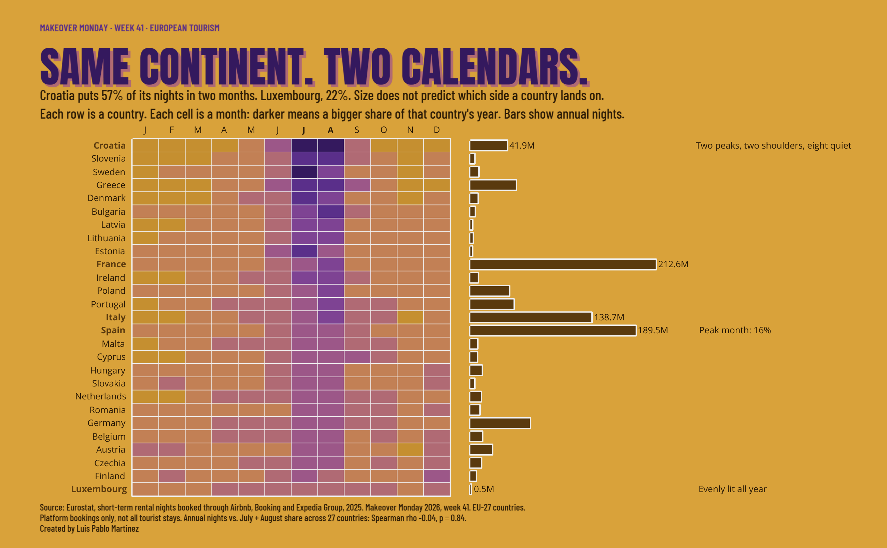

# Week 41 · European Tourism



**Tableau Public:** https://public.tableau.com/app/profile/luis.pablo6724/viz/EuroTourism/EuroTourism

Guest nights booked through Airbnb, Booking and Expedia Group in 2025, for the 27 EU countries.
One question: does a country's size predict how much of its year falls in July and August?

## The finding

- Croatia puts 57.0% of its platform nights in July and August, the highest of the 27. Luxembourg puts 21.6%, the flattest.
- France is first by volume at 212.6M nights, and 34.8% of its year falls in July and August.
- Annual nights do not predict the July and August share: Spearman rho -0.04, p = 0.84.

"Platform nights" are nights booked through those three platforms, not all tourist stays.

## How it is built

Python decides, Tableau paints. Every position, color, label and tooltip string is computed in
Python and written to one CSV; Tableau draws marks from it with `MAKEPOINT`.

| Stage | Script | Output |
|---|---|---|
| 1. Reshape | `build_tourism.py` | `tourism_2025_long.csv` |
| 2. Findings | `explore_euro_tourism.py` | `euro_tourism_stage2.csv`, `euro_tourism_monthly_stage2.csv` |
| 3. Canvas | `build_euro_tourism_canvas.py` | `euro_tourism_canvas.csv` + `euro_header.png` |

Claims in the dashboard text are asserted against the data in the script that draws them.
Headline and footer are rendered to PNG in Python because Tableau handles custom fonts unreliably.

## Decisions

- **Country level only (27 EU countries).** The source also lists regions at several NUTS levels, which nest inside each other and double-count if summed.
- **Share, not volume.** Each cell is a month's share of that country's own year, so countries of any size compare on one scale.
- **Platform nights are one slice of tourism.** Comparisons to Eurostat's all-accommodation figures would be wrong, so none are made.

## Reproduce

```
python -m venv .venv && source .venv/bin/activate
pip install -r ../requirements.txt
sh fetch_fonts.sh
cp paths_local.example.py paths_local.py        # then edit OUT if you want
# put the Makeover Monday week 41 workbook in drop/ as Tourism_2025.xlsx
python build_tourism.py
python explore_euro_tourism.py
python build_euro_tourism_canvas.py
```

To run stage 3 only, use the committed stage 2 CSVs.

## Credits

- Makeover Monday 2026, week 41. Data: Eurostat.
- Fonts: Anton, Barlow Condensed, Open Sans (SIL Open Font License).