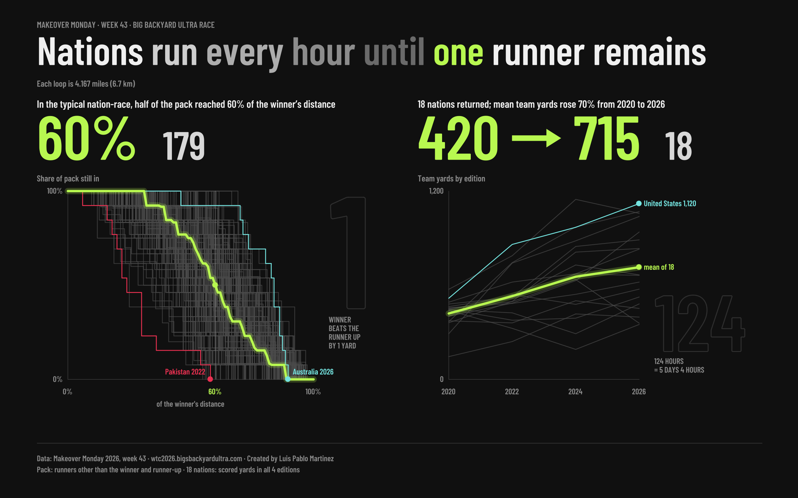

# wk43: Big's Backyard Ultra World Team Championship, 2020-2026

Makeover Monday 2026, week 43. Nations run every hour until one runner remains. Two findings, one page.

<a href="https://public.tableau.com/app/profile/luis.pablo6724/viz/UltraRace/UltraRace"></a>

**Poster:** [Tableau Public](https://public.tableau.com/app/profile/luis.pablo6724/viz/UltraRace/UltraRace). Hover any line for its numbers. Built for desktop.

## What it shows

Each nation runs its own race: a new yard (4.167 miles) every hour, until one runner is left. The nation's score is the total yards of all its runners.

- **The pack.** In the typical nation-race, half of the pack reached 60% of the winner's distance. 179 nation-races, each drawn as a step line of the share of the pack still running. The winner runs 1.67x the median pack runner. Australia 2026 is the tightest pack (the median runner reached 84% of the winner's distance). Pakistan 2022 is the breakaway (50 and 49 yards, then 29, with a pack median of 24%).
- **The nations that kept coming back.** 18 nations scored yards in all four editions. Their mean team yards rose from 420 in 2020 to 715 in 2026, up 70%. The United States is highest in 2026 at 1,120.
- **Two facts from the format.** In every nation-race with a winner, the winner is exactly one yard past the runner-up (179 of 179). The longest 2026 nation race ran 124 hours, 5 days and 4 hours.

## How the numbers are made

`explore_ultra_race.py` reads two tabs of the workbook (`runner_results`, `nation_years`) and writes the hand-off files the poster is drawn from:

- `headline.json`: the nine numbers that appear in type or captions.
- `step_curves.csv`: one step line per nation-race (3,579 rows) with the nation, winner yards, pack size and the half-pack percent.
- `median_curve.csv`: the median share of the pack still in, at each percent of the winner's distance (101 rows).
- `constant_nations.csv`: team yards for the 18 nations across four editions (72 rows).

Definitions:

- **Pack** is the runners other than the winner and the runner-up (the source calls the runner-up the assist). Counting everyone moves the 60% to 58%.
- **Share still in** at a point is the share of the pack whose yards reach that percent of the winner's yards. The median is taken across the 179 nation-races.
- **Constant nations** scored yards in all four editions (2020, 2022, 2024, 2026).
- 179 of 190 nation-years had a winner. The other 11: 6 ended in a tie (the last runners stopped on the same yard), 4 did not start, 1 was cancelled. Six teams with fewer than 12 runners are included.

Every number in large type is asserted in the script: the 179 races, the 60% landmark (computed two ways), 420 and 715, the 18 nations, the one-yard gap (179 of 179), 124 hours (the longest 2026 run).

## Run it

```
pip install pandas openpyxl
python3 explore_ultra_race.py
```

It expects `drop/bigs_backyard_wtc_2020_2026.xlsx` (tabs: README, runner_yards, runner_results, nation_years). The data file is not included. Outputs go to `~/TableauData/Ultra Race/`.

## Notes

- Data: Makeover Monday 2026, week 43, from wtc2026.bigsbackyardultra.com.
- All text on the poster, including the small labels, is drawn as polygons, so it does not depend on the viewer's fonts. Type is Barlow Condensed.
- On the public page: about 3 seconds to interactive, hovers 0.2 to 0.45 seconds, a click about 2.2 seconds. Clicking a mark fades the rest of the chart; click empty space to reset. Best at a window 1,440 px wide or larger; narrower windows clip the right side.
- The script that turns these tables into the Tableau geometry is kept private.
- Built with AI assistance.
