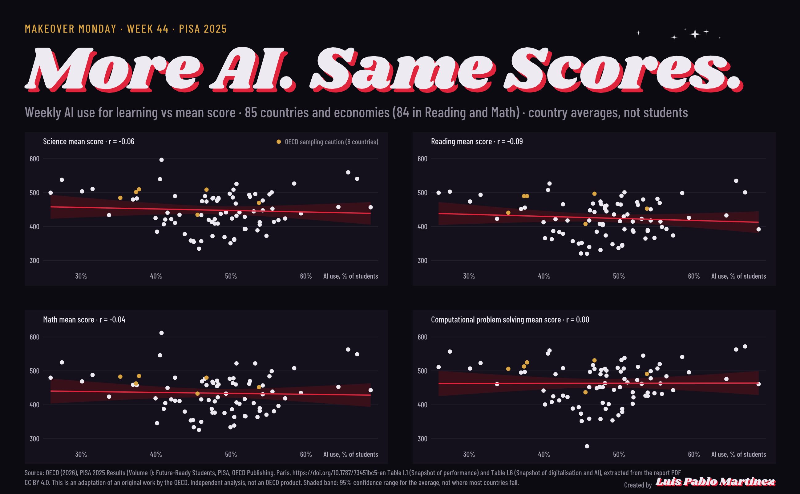
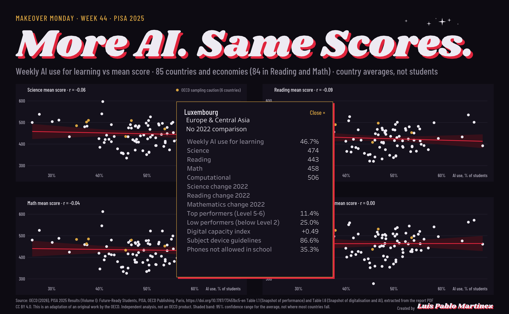

# Week 44: More AI. Same Scores. PISA 2025

Makeover Monday, week 44. Do countries where more students use AI for learning score higher on PISA 2025?

**Live dashboard:** [More AI. Same Scores. on Tableau Public](https://public.tableau.com/app/profile/luis.pablo6724/viz/PISA2025AIUse/AIUseVsPISAScores)

Click a dot and a country card opens with its full profile:

## The short answer

No. Across 85 countries and economies, weekly AI use for learning shows no detectable link with mean scores:

| Measure | r |
|---|---|
| Science | -0.06 |
| Reading | -0.09 |
| Math | -0.04 |
| Computational problem solving | 0.00 |

Each panel carries a fit line with a shaded 95% confidence band for the average. The band shows the uncertainty of the fitted line, not where most countries fall.

## What the dashboard shows

- Four panels, one per measure. Each dot is a country: weekly AI use for learning (% of students) on the x axis, mean score on the y axis.
- Gold dots mark the six OECD countries flagged for sampling caution.
- Click a dot to open that country's card: AI use, the four scores, change since 2022, top and low performer shares, digital capacity index, subject device guidelines, and phones not allowed in school. Close it with the Close button, or click empty space.
- Hover a dot or the band for a tooltip.

## Read this before drawing conclusions

- **These are country averages, not students.** A flat line across countries says nothing about whether AI helps or hurts an individual student.
- The report's own student-level findings are mixed.
- **Uzbekistan:** Reading and Math were not reported, so 84 countries appear in those two panels.
- Correlation is not causation.

## Data and license

OECD (2026), *PISA 2025 Results (Volume I): Future-Ready Students*, PISA, OECD Publishing, Paris, https://doi.org/10.1787/73451bc5-en. Tables I.1 (Snapshot of performance) and I.6 (Snapshot of digitalisation and AI), extracted from the report PDF.

CC BY 4.0. This is an adaptation of an original work by the OECD. Independent analysis, not an OECD product.

The source workbook is not committed to this repo. To rebuild, get the tables from the report above, save them as `raw/PISA2025.xlsx`, and run `build_pisa_canvas.py`. The Tableau workbook can be downloaded from the [Tableau Public page](https://public.tableau.com/app/profile/luis.pablo6724/viz/PISA2025AIUse/AIUseVsPISAScores).

Tableau Public extracted the data at publish time, so the live dashboard does not update if the source changes. Any fix needs a republish.

## How it was built

The scatters, fit lines, bands, grid, title lettering and country card are drawn as polygon marks in layered map panes (about 56,000 polygon rows), so everything sits inside one visualization. Layers, back to front: back, grid, band, data, text, card frame, card name, close button. A parameter action opens the card from a dot click, a Close action resets it, and Dynamic Zone Visibility hides the card when the parameter is `none`. The title uses custom glyphs drawn as polygons so the lettering does not depend on installed fonts.

## Performance

Measured on the published page with the browser's network panel (Tableau Public, signed-out session, 5 clicks). Time is the server response to the click, which is when the dashboard has what it needs to redraw.

| Action | Time |
|---|---|
| Click (open or close the card) | median 3.6 s, range 2.7 to 7.7 s |
| After-click state refresh | 0.13 to 0.2 s |
| First draw | [not captured] |
| Hover tooltip | [not captured] |

The card carries about 56,000 polygon rows, and every click re-queries it, so interactions are slower than a typical Tableau Public dashboard (an earlier, lighter build, Brazil, took 1.2 to 1.55 s per click).

## Known limitations

- The card text uses Open Sans. Tableau Public cannot embed fonts, so viewers without it see a fallback. The polygon text is unaffected.
- Desktop layout only (fixed 1300 x 805).
- Clicks take a few seconds (see Performance).
- Static data, as above.

## Files in this folder

| File | Purpose |
|---|---|
| `explore_pisa_2025.py` | Exploration and correlations |
| `build_pisa_canvas.py` | Builds the polygon canvas for Tableau |
| `font_test.py` | Font check for the title glyphs |
| `screenshots/` | Dashboard images |
| `TIMELOG_wk44.md` | Time log |

Profiling uses `../toolkit/scan_and_profile.py`. Built by Luis Pablo Martinez with the shared `../toolkit/`.