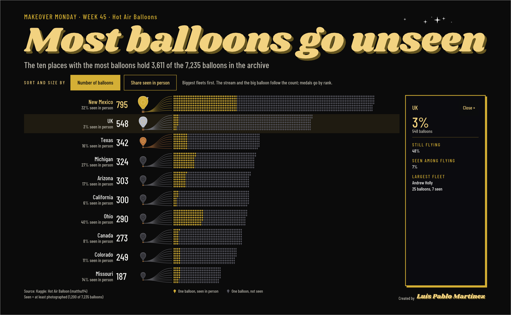
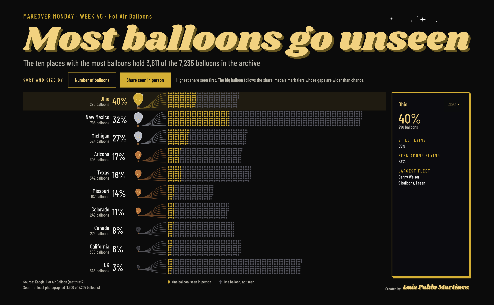

# Week 45: Most balloons go unseen. Hot air balloons

Makeover Monday, week 45. Which are the top ten places for hot air balloons? How many of the hot air balloons are seen?

**Live dashboard:** [Most balloons go unseen. on Tableau Public](https://public.tableau.com/app/profile/luis.pablo6724/viz/HotAirBalloonMakeoverMonday/HotAirBalloons)

Click a balloon to see why:

## The short answer

- 7,235 balloons in the archive, 1,200 seen, which is 16.6%
- Top ten places hold 3,611, about 50%
- Ohio: 290 balloons, 40% seen, the highest of the ten. The UK: 548 balloons, 3%, the lowest. New Mexico leads with 795, 32% seen.

## What the dashboard shows

- Top ten places with hot air balloons sorted by number of balloons or share seen in person
- Gold balloons are seen, grey balloons are unseen
- Click a balloon and a card opens to show location, percent seen, total, still flying, seen among flying, largest fleet
- Size follows the metric
- Rank shows in medals

## Read this before drawing conclusions

- **These are balloons seen without a definition.** Columns Seen in person and seen have matching values. It is reasonable to conclude they measure the same data. The dashboard creator made an educated interpretation that seen and seen in person mean at least photographed.
- **Not all balloons included.** Visual shows the top ten locations with most hot air balloons.

## Data and license

Source: Kaggle, Hot Air Balloon (matthuff4) https://www.kaggle.com/datasets/matthuff4/hot-air-balloon

Released under MIT License

Copyright (c) 2013 Mark Otto.

Copyright (c) 2017 Andrew Fong.

1. Download `hot_air_balloon.xlsx` and save it as `raw/hot_air_balloon.xlsx`. 
2. Clean the file with `clean_balloon.py`. 
3. Run `explore_balloon.py`. 
4. Execute `build_balloon_canvas.py`. The script writes `balloon_canvas.csv` to `~/TableauData/wk45-hot-air-balloon/`

The canvas script also needs the fonts in `../toolkit/fonts/`. The Tableau workbook can be downloaded from the [Tableau Public page](https://public.tableau.com/app/profile/luis.pablo6724/viz/HotAirBalloonMakeoverMonday/HotAirBalloons).

Tableau Public extracted the data at publish time, so the live dashboard does not update if the source changes. Any fix needs a republish.

## How it was built

One marks layer. Color sets the draw order through a z column. Two parameters and dashboard actions. 

CSV holds 167,332 rows. Around 66,000 marks per view. 

## Performance

Measured on the published page with the browser's network panel (Tableau Public, signed-out session, 11 clicks). Time is the server response to the click, which is when the dashboard has what it needs to redraw.

| Action | Time |
|---|---|
| Click, view changed (9 clicks) | median 1.25 s, range 1.1 s to 1.34 s |
| Click, nothing changed (2 clicks) | 0.16 s |
| After-click refresh | 0.07 s to 0.22 s |

First draw: the first image arrived about 4.1 s into the capture.

Median click comparison -- Week 44 median of 3.6 s vs Week 45 of 1.25 s.

## Files in this folder

| File | Purpose |
|---|---|
| `clean_balloon.py` | Transform and tidy data |
| `explore_balloon.py` | Exploration for insights analysis |
| `build_balloon_canvas.py` | Builds the polygon canvas for Tableau |
| `screenshots/` | Dashboard images |

Profiling uses `../toolkit/scan_and_profile.py`. Built by Luis Pablo Martinez with the shared `../toolkit/`.