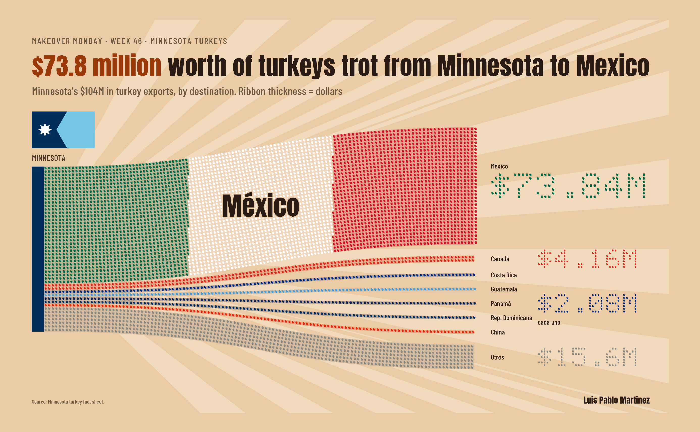

# Week 46: Minnesota Turkeys

**Live dashboard:** [Minnesota Turkey Exports on Tableau Public](https://public.tableau.com/app/profile/luis.pablo6724/viz/MinnesotaTurkey/MinnesotaTurkeys)

**Makeover Monday week 46** · data: Minnesota turkey fact sheet

## The idea
$73.8 million worth of turkeys trot from Minnesota to Mexico.
Minnesota's $104M in turkey exports, by destination. Ribbon thickness = dollars.

## How it's built
1. `build_turkey_canvas.py` writes `turkey_canvas.csv`, one row  per polygons vertex and Tableau draws its geometry.
2. Tableau: needs one calculation: GEOM = MAKEPOINT(lat,lon). The mark type is Polygon, with Point Order on Path, Poly Id on Detail, and Color on Color. Color is sorted by Z, aggregated to MIN.  
3. The color map: 33 hex codes are pasted in the .twb to map the color palette to its corresponding hex.

## Numbers
| | |
|---|---|
| Canvas | 1387 x 857 |
| Turkeys | 5,890 |
| CSV rows / polygons | 109,595 / 19,115 |
| Colors | 33 |
| First load | about 1.9 s on Tableau Public |

## What I learned
- The headline is two glyph_rows calls, and only the first part, "$73.8 million", ises the accent color. 
- Spanish needs é, í and á. assert_glyphs checks the font has them before anything is drawn..
- All custom type is made in Python because Tableau handles fonts unreliably.

## Files
- `clean_turkey.py` ... reads the fact sheet and writes one clean CSV per table
- `build_turkey_canvas.py` ... builds the canvas: writes `turkey_canvas.csv`, `turkey_palette.tps` and `turkey_color_map.xml`
- `turkey_color_map.xml` ... the 33 color entries to paste into the workbook's color encoding
- `screenshots/` ... the dashboard preview used above